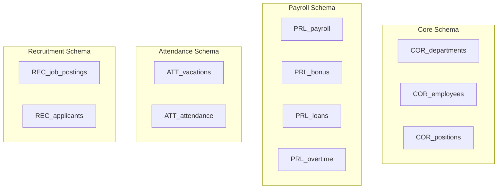

# 🏢 Human Resources Management System Database (HR_DATABASE_DB)

[English](#english-version) | [العربية](#النسخة-العربية)

---

## النسخة العربية

### 📝 وصف المشروع
مشروع **قاعدة بيانات إدارة الموارد البشرية المتكاملة** هو نظام مصمم لإدارة رأس المال البشري بكفاءة وتوسعية عالية باستخدام **SQL Server (SSMS)**. تم بناء النظام بالاعتماد على معايير هندسة البيانات المتقدمة لضمان أمن البيانات، تكاملها، وحوكمتها عبر فصل المهام والوظائف الأساسية.

### 📐 الهندسة المعمارية وقسم المخططات (Schema Design)
تم تقسيم النظام إلى **4 مخططات رئيسية (Schemas)** تحتوي على **11 جدولاً منظماً** مترابطة بشكل وثيق حول الجدول المركزي للموظفين لضمان تقليل التكرار (Normalization):

1. **مخطط النواة (Core Schema):**
   * يحتوي على البيانات الأساسية للموظفين، الهيكل التنظيمي للأقسام، والمسميات الوظيفية.
   * *الجداول:* `COR_employees` (الجدول الأساسي)، `COR_departments`، `COR_positions`.
2. **مخطط الأجور والرواتب (Payroll Schema):**
   * يعنى بإدارة المستحقات المالية، الرواتب الأساسية، البدلات، والتعديلات المالية مع تطبيق معايير التشفير للحماية.
   * *الجداول:* جداول مسؤولة عن مسيرات الرواتب والمراقبة مثل `PRL_payroll` و `PRL_payroll_audit`.
3. **مخطط الحضور والغياب (Attendance Schema):**
   * يراقب سجلات الدخول والخروج اليومية، طلبات الإجازات، والأرصدة المستحقة لكل موظف.
   * *الجداول:* جداول التحضير والإجازات مثل `ATT_vacations`.
4. **مخطط الاستقطاب والتوظيف (Recruitment Schema):**
   * يغطي حراج الكفاءات بدءاً من المتقدمين للوظائف، المقابلات الشخصية، وحتى اتخاذ قرار التعيين.

### 🔒 الحوكمة والأمن الرقمي
* **إدارة الصلاحيات (DBA Role):** تم عزل سكريبت التأسيس الرئيسي والـ Passwords الحقيقية محلياً عن طريق قواعد Git الصارمة، وإتاحة ملف تمبلت آمن للعرض يعتمد على دور `db_owner` لحساب إدارة النظام `DBA_Admin`.
* **سرية البيانات:** عزل جداول الرواتب الحساسة برمجياً تمهيداً لتطبيق التشفير الشامل للبيانات المالية الحساسة.
  ## 🗄️ هيكل قاعدة البيانات (Database Schema)

تم تصميم قاعدة بيانات النظام بشكل مجزأ وموزع على **4 مخططات رئيسية (Schemas)** لضمان تنظيم البيانات وسهولة إدارتها:

### 1. 👥 مخطط النواة (Core Schema - COR)
يحتوي هذا المخطط على البيانات الأساسية والهيكلية للمنشأة، ويضم **3 جداول**:
* **`COR_departments`** (الأقسام): لإدارة وتصنيف الأقسام الإدارية داخل المنشأة.
* **`COR_employees`** (الموظفين): يحتوي على البيانات الشخصية والأساسية لجميع الموظفين.
* **`COR_positions`** (الوظائف والمراتب): لإدارة المسميات الوظيفية، السلالم، والمراتب الوظيفية.

### 2. 💰 مخطط الرواتب والمالية (Payroll Schema - PRL)
يختص بإدارة العمليات المالية والتعويضات الخاصة بالموظفين، ويضم **4 جداول**:
* **`PRL_payroll`**: يضم مسيرات الرواتب الأساسية، صافي الرواتب، والاستقطاعات الضريبية.
* **`PRL_bonus`**: لمتابعة المكافآت المالية وحالات اعتماده أو صرفها.
* **`PRL_loans`**: لإدارة السلف والقروض الشخصية للموظفين وجدولة الأقساط.
* **`PRL_overtime`**: لتسجيل واحتساب ساعات العمل الإضافية المستحقة.

### 3. 📅 مخطط الحضور والإجازات (Attendance Schema - ATT)
يتابع حركة الموظفين ومواظبتهم اليومية، ويضم **جدولين**:
* **`ATT_vacations`**: لإدارة الإجازات بمختلف أنواعها (سنوية، مرضية، اضطرارية) ومتابعة رصيدها.
* **`ATT_attendance`**: يحتوي على سجلات الحضور والانصراف اليومية والدقيقة للموظفين.

### 4. 🤝 مخطط التوظيف (Recruitment Schema - REC)
يختص بطلب واستقطاب الكفاءات الجديدة وتصفيتها، ويضم **جدولين**:
* **`REC_job_postings`**: لمتابعة الوظائف الشاغرة والمعلنة والمتوفرة في المنشأة.
* **`REC_applicants`**: يحتوي على بيانات المتقدمين للوظائف ونظام الفرز والتصفية الأولي.
### 📊 مخطط مرئي للعلاقات العامة (High-Level Schema Map)

---

## English Version

### 📝 Project Overview
The **HR Management System Database** is an enterprise-grade relational database architecture engineered utilizing **SQL Server (SSMS)**. The system is meticulously designed to optimize human capital operations, reinforce data integrity, and ensure strict data governance through separation of concerns.

### 📐 Database Architecture & Schema Layout
The database features **4 modular schemas** governing **11 interrelated tables**, structured around a central employee entity to achieve optimal normalization and scalability:

1. **Core Schema:**
   * Manages enterprise foundation data including central identity records, corporate departments, and organizational roles.
   * *Key Entities:* `COR_employees` (Central Master Table), `COR_departments`, `COR_positions`.
2. **Payroll Schema:**
   * Controls financial ledger records, basic salaries, benefits, allowances, and compensation tracking with encryption readiness.
   * *Key Entities:* Financial tracking and auditing modules such as `PRL_payroll` and `PRL_payroll_audit`.
3. **Attendance Schema:**
   * Monitors daily logs, timesheets, vacation cycles, and statutory time-off balances.
   * *Key Entities:* Time-tracking tables such as `ATT_vacations`.
4. **Recruitment Schema:**
   * Tracks target talent pipelines from applicants and interview staging up to hiring decisions.

### 🔒 Governance & Security Strategy
* **Privilege Management (DBA Role):** Implemented a rigorous security baseline using localized Git environment isolation. Server logins and database users (`DBA_Admin_User`) are mapped to the `db_owner` role using secure templates.
* **Data Privacy:** Strategic physical and logical isolation of financial elements to prepare for granular column-level data encryption.
