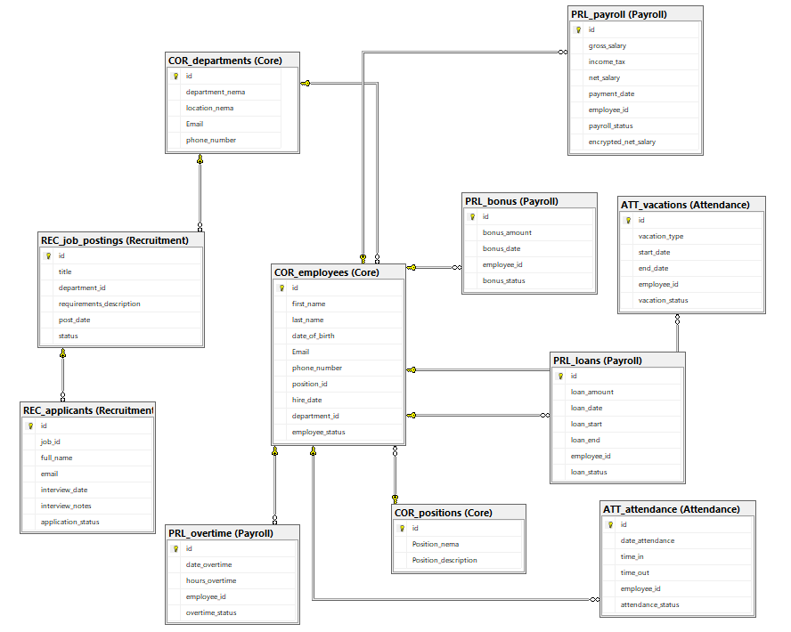

# 🏢 Human Resources Management System Database (HR_DATABASE_DB)

[English](#english-version) | [العربية](#النسخة-العربية)

## النسخة العربية

### 📝 وصف المشروع
مشروع **قاعدة بيانات إدارة الموارد البشرية المتكاملة** هو نظام مصمم لإدارة رأس المال البشري بكفاءة وتوسعية عالية باستخدام **SQL Server (SSMS)**. تم بناء النظام بالاعتماد على معايير هندسة البيانات المتقدمة لضمان أمن البيانات، تكاملها، وحوكمتها عبر فصل المهام والوظائف الأساسية.

### 📐 الهندسة المعمارية وقسم المخططات (Schema Design)
تم تقسيم النظام إلى **4 مخططات رئيسية (Schemas)** تحتوي على **11 جدولاً منظماً** مترابطة بشكل وثيق حول الجدول المركزي للموظفين لضمان تقليل التكرار (Normalization):

1. **مخطط النواة (Core Schema):**
   * يحتوي على البيانات الأساسية للموظفين، الهيكل التنظيمي للأقسام، والمسميات الوظيفية.
   * *الجداول:* `COR_employees` (الجدول الأساسي)، `COR_departments`، `COR_positions`.
2. **مخطط الأجور والرواتب (Payroll Schema):**
   * يعنى بإدارة المستحقات المالية، الرواتب الأساسية، البدلات، والتعديلات المالية مع تطبيق معايير التشفير للحماية.
   * *الجداول:* جداول مسؤولة عن مسيرات الرواتب والمراقبة مثل `PRL_payroll` و `PRL_payroll_audit`.
3. **مخطط الحضور والغياب (Attendance Schema):**
   * يراقب سجلات الدخول والخروج اليومية، طلبات الإجازات، والأرصدة المستحقة لكل موظف.
   * *الجداول:* جداول التحضير والإجازات مثل `ATT_vacations`.
4. **مخطط الاستقطاب والتوظيف (Recruitment Schema):**
   * يغطي حراج الكفاءات بدءاً من المتقدمين للوظائف، المقابلات الشخصية، وحتى اتخاذ قرار التعيين.

### 🔒 الحوكمة والأمن الرقمي
* **إدارة الصلاحيات (DBA Role):** تم عزل سكريبت التأسيس الرئيسي والـ Passwords الحقيقية محلياً عن طريق قواعد Git الصارمة، وإتاحة ملف تمبلت آمن للعرض يعتمد على دور `db_owner` لحساب إدارة النظام `DBA_Admin`.
* **سرية البيانات:** عزل جداول الرواتب الحساسة برمجياً تمهيداً لتطبيق التشفير الشامل للبيانات المالية الحساسة.

### 💾 إستراتيجية النسخ الاحتياط(Database Backup)
* **إستراتيجية النسخ الاحتياطي (Database Backup):** تم بناء خطة متكاملة لتأمين البيانات وضمان استمرارية النظام عبر تفعيل خيارات الاستعادة المختلفة:
  * **النسخ الكامل `Full`:** يتضمن أخذ نسخة شاملة لكافة البيانات والمخططات والجداول في النظام لضمان الاستعادة الكلية عند الطوارئ.
  * **النسخ التفاضلي `Differential`:** يختص بحفظ التغييرات التراكمية التي تمت فقط بعد آخر نسخ كامل لتوفير مساحة التخزين ووقت التنفيذ.
  * **نسخ سجل العمليات `Transaction Log`:** لمراقبة وتوثيق العمليات اللحظية، مما يتيح ميزة الاستعادة لنقطة زمنية محددة بدقة وعودة النظام لآخر حالة مستقرة قبل الفقدان.

### ⚡ هندسة تحسين الأداء والتصفية السريعة
* **فهرسة البيانات (Database Indexing):** تم تصميم وبناء فهارس فريدة وغير متجمعة استباقياً على المخططات والجداول الحيوية لرفع كفاءة الاستعلامات وتسريع عمليات الربط `JOIN`:
  * **مخطط النواة `Core Schema`:** إنشاء فهرس فريد `IX_COR_employees_Email` لتسريع عمليات تسجيل الدخول والبحث بالبريد الإلكتروني، وفهرس مركب `IX_COR_employees_Dept_Position` لتسريع تقارير ربط الموظفين بأقسامهم ومسمياتهم الوظيفية.
  * **مخطط الحضور والغياب `Attendance Schema`:** بناء فهارس مركبة `IX_ATT_attendance_Employee_Date` و `IX_ATT_vacations_Employee_Dates` لتسريع استعلامات لوحات التحكم (Dashboards) الخاصة ببيانات الحضور اليومي وتواريخ الإجازات.
  * **مخطط الأجور والرواتب `Payroll Schema`:** إنشاء فهرس `IX_PRL_payroll_Employee_Status` على جدول الرواتب لتسريع عمليات جلب المسودات المالية ومراقبة حالات صرف الرواتب وتدقيقها ماليًا.
  * **الهيكلة البرمجية الاستباقية `Metadata Setup`:** تم تأسيس الفهارس مسبقاً قبل مرحلة تغذية البيانات لضمان جهوزية النظام واستقراره اللحظي، وتجنب عمليات قفل الجداول `Table Locks` أو بطء الخادم مستقبلاً.

### 🤖 أتمتة العمليات وحوكمة البيانات (Database Triggers)
* **مشغلات التدقيق والمطابقة المؤتمتة (Triggers):** تم تطوير وبناء مشغلات برمجية متقدمة على مستوى الخادم لتعمل تلقائياً عند تعديل البيانات، مما يضمن الحوكمة الكاملة للمخططات وبناء سجلات مراقبة تاريخية دقيقة:
  * **مراقبة البيانات المهنية للموظفين:** تفعيل المشغل البرمجي `trg_AuditEmployeeChanges` على جدول الموظفين الأساسي لمراقبة عمليات التحديث والحذف (`AFTER UPDATE, DELETE`)، حيث يقوم تلقائياً برصد أي تغيير في البيانات الهيكلية الحساسة كالمسمى الوظيفي أو القسم ونقلها لجدول المراقبة `COR_employees_audit`.
  * **التدقيق المالي ومراقبة الأجور:** بناء المشغل البرمجي `trg_AuditPayrollSalaryChanges` على جدول الرواتب لتعقب التغييرات في الراتب الإجمالي (`gross_salary`)، وضمان توثيق التعديلات المالية بدقة مع تحسين استهلاك موارد الخادم ومساحة التخزين عبر تسجيل الحركات الفعلية فقط.
  * **حماية وحوكمة دورة حياة القروض:** إدراج المشغل البرمجي `trg_AuditLoanChanges` لمراقبة حركات وجدولة القروض والسلف الشخصية، مما يضمن تسجيل وتوثيق أي تحديث في مبالغ القروض أو حالات الاعتماد والصرف تلقائياً في جدول التدقيق المالي `PRL_loans_audit`.

## 🗄️ بنية وهندسة قاعدة البيانات (Database Architecture)

تم تصميم قاعدة بيانات النظام استناداً إلى مفهوم **المخططات المجزأة (Sub-schemas/Modules)** لضمان كفاءة الأداء، عزل الصلاحيات، وسهولة التوسع المستقبلي. ينقسم النظام إلى **4 مخططات رئيسية** موزعة كالتالي:

### 1. 👥 مخطط البيانات الأساسية | Core Schema (`COR`)
يمثل النواة المركزية للنظام ويحتوي على البيانات الهيكلية للمنظمة وعلاقات الموظفين الأساسية (**3 جداول**):
* **`COR_departments`** ── (الأقسام) إدارة الهيكل الإداري، القطاعات، والفروع داخل المنشأة.
* **`COR_employees`** ── (الموظفين) الملفات التعريفية للموظفين، البيانات الشخصية، وحالات التعيين.
* **`COR_positions`** ── (الوظائف والمراتب) المسميات الوظيفية، التوصيف الوظيفي، والدرجات/السلالم الوظيفية.

### 2. 💰 مخطط الرواتب والمالية | Payroll Schema (`PRL`)
يختص بكافة العمليات الحسابية، التعويضات، والالتزامات المالية الخاصة بالموارد البشرية (**4 جداول**):
* **`PRL_payroll`** ── (مسيرات الرواتب) احتساب الرواتب الأساسية، البدلات، الاستقطاعات الضريبية، وصافي المستحقات.
* **`PRL_bonus`** ── (المكافآت) إدارة الحوافز والمكافآت الدورية مع تتبع حالات الاعتماد والصرف الدقيق.
* **`PRL_loans`** ── (القروض والأقساط) تنظيم السلف والقروض الشخصية وجدولة الاستقطاعات الشهرية المؤتمتة.
* **`PRL_overtime`** ── (العمل الإضافي) رصد وتدقيق ساعات العمل الإضافية واحتساب التعويض المالي المقابل لها.

### 3. 📅 مخطط إدارة الحضور والإجازات | Attendance Schema (`ATT`)
يتحكم في تتبع انضباط القوى العاملة وإدارة الإجازات الرسمية والخاصة (**جدولين**):
* **`ATT_vacations`** ── (الإجازات) إدارة طلبات الإجازات بمختلف أنواعها، وتتبع الأرصدة المستحقة والمستهلكة.
* **`ATT_attendance`** ── (سجلات الحضور) السجلات اليومية لعمليات الحضور، الانصراف، التأخير، والغياب بشكل دقيق.

### 4. 🤝 مخطط الاستقطاب والتوظيف | Recruitment Schema (`REC`)
يغطي الدورة الكاملة لجلب الكفاءات وتصفية المتقدمين الجدد للنظام (**جدولين**):
* **`REC_job_postings`** ── (الوظائف الشاغرة) إدارة وتتبع الفرص الوظيفية المعلنة ومواصفات كل شاغر وظيفي.
* **`REC_applicants`** ── (المتقدمين للوظائف) قاعدة بيانات المتقدمين، تتبع مراحل المقابلات، وأنظمة الفرز والتصفية الأولي.

---

## English Version

### 📝 Project Overview
The **HR Management System Database** is an enterprise-grade relational database architecture engineered utilizing **SQL Server (SSMS)**. The system is meticulously designed to optimize human capital operations, reinforce data integrity, and ensure strict data governance through separation of concerns.

### 📐 Database Architecture & Schema Layout
The database features **4 modular schemas** governing **11 interrelated tables**, structured around a central employee entity to achieve optimal normalization and scalability:

1. **Core Schema:**
   * Manages enterprise foundation data including central identity records, corporate departments, and organizational roles.
   * *Key Entities:* `COR_employees` (Central Master Table), `COR_departments`, `COR_positions`.
2. **Payroll Schema:**
   * Controls financial ledger records, basic salaries, benefits, allowances, and compensation tracking with encryption readiness.
   * *Key Entities:* Financial tracking and auditing modules such as `PRL_payroll` and `PRL_payroll_audit`.
3. **Attendance Schema:**
   * Monitors daily logs, timesheets, vacation cycles, and statutory time-off balances.
   * *Key Entities:* Time-tracking tables such as `ATT_vacations`.
4. **Recruitment Schema:**
   * Tracks target talent pipelines from applicants and interview staging up to hiring decisions.

### 🔒 Governance & Security Strategy
* **Privilege Management (DBA Role):** Implemented a rigorous security baseline using localized Git environment isolation. Server logins and database users (`DBA_Admin_User`) are mapped to the `db_owner` role using secure templates.
* **Data Privacy:** Strategic physical and logical isolation of financial elements to prepare for granular column-level data encryption.

### 💾 Database Backup Strategy
* **Database Backup & Recovery Planning:** Developed a bulletproof disaster recovery strategy to ensure high availability and prevent data loss across various recovery models:
  * **Full Backup `Full`:** Conducts a comprehensive snapshot of all schemas, system structures, and transaction tables for complete system baseline recovery.
  * **Differential Backup `Differential`:** Captures cumulative transaction changes since the last Full backup to optimize physical disk storage allocation and reduce execution downtime.
  * **Transaction Log Backup `Transaction Log`:** Tracks transactional operations incrementally, enabling reliable point-in-time recovery (PITR) to restore the environment to its last stable state before failure.

### ⚡ Performance Optimization & Indexing
* **Database Indexing Strategy:** Proactively designed and implemented unique and non-clustered indexes across mission-critical schemas to maximize query engine response times and optimize complex `JOIN` execution paths:
  * **Core Schema:** Deployed a unique index `IX_COR_employees_Email` to optimize corporate login verification, and a composite index `IX_COR_employees_Dept_Position` to accelerate high-frequency cross-departmental organizational reporting.
  * **Attendance Schema:** Implemented composite indexes `IX_ATT_attendance_Employee_Date` and `IX_ATT_vacations_Employee_Dates` to eliminate table scans during dashboard rendering of daily timesheets and leave schedules.
  * **Payroll Schema:** Provisioned a targeted index `IX_PRL_payroll_Employee_Status` to accelerate the retrieval of active financial drafts and expedite auditing workflows.
  * **Proactive Metadata Setup:** All structural indexes were provisioned ahead of initial data seeding to ensure day-one query efficiency, eliminating future database deadlocks, `Table Locks`, or production server degradation.
 
### 🤖 Process Automation & Ledger Governance (Database Triggers)
* **Automated Audit & Compliance Triggers:** Engineered advanced database triggers to implicitly capture data modifications, enforce structural integrity, and build reliable historical transaction logs:
  * **Employee Staging & Career Tracking:** Deployed an active auditing trigger `trg_AuditEmployeeChanges` on the core employee directory to monitor structural updates and data deletions, automatically intercepting historical adjustments to position or department bounds.
  * **Financial & Compensation Ledger Auditing:** Implemented a targeted evaluation trigger `trg_AuditPayrollSalaryChanges` to monitor gross salary variations, capturing active shifts to financial packages while optimizing server execution storage.
  * **Loan Lifecycle & Balance Verification:** Provisioned a continuous validation trigger `trg_AuditLoanChanges` to track the issuance, adjustment, and cancellation of corporate advances, ensuring zero-downtime ledger validation.

## 🗄️ Database Architecture & Schema Design

The database is architected using a modular **Multi-Schema approach** to ensure high performance, strict data isolation, role-based access control, and seamless scalability. The system is split into **4 core domains**:

### 1. 👥 Core Schema (`COR`)
Serves as the backbone of the application, managing structural organization and employee profiles (**3 Tables**):
* **`COR_departments`** ── Manages organizational hierarchy, divisions, and company branches.
* **`COR_employees`** ── Stores master employee profiles, personal records, and employment statuses.
* **`COR_positions`** ── Defines job titles, role descriptions, salary grades, and ranks.

### 2. 💰 Payroll Schema (`PRL`)
Handles all financial computations, compensations, and monetary liabilities (**4 Tables**):
* **`PRL_payroll`** ── Computes base salaries, allowances, tax deductions, and net payouts.
* **`PRL_bonus`** ── Tracks performance bonuses, incentives, and approval workflows.
* **`PRL_loans`** ── Manages employee advances, loans, and automated monthly installment scheduling.
* **`PRL_overtime`** ── Logs extra working hours and calculates respective monetary compensations.

### 3. 📅 Attendance Schema (`ATT`)
Tracks workforce time management, daily discipline, and time-off requests (**2 Tables**):
* **`ATT_vacations`** ── Manages leave requests (annual, medical, casual) and tracks time-off balances.
* **`ATT_attendance`** ── Records precise daily clock-in/out timestamps, delays, and absences.

### 4. 🤝 Recruitment Schema (`REC`)
Facilitates the talent acquisition lifecycle and applicant tracking workflows (**2 Tables**):
* **`REC_job_postings`** ── Publishes and manages active job openings, requirements, and vacancies.
* **`REC_applicants`** ── Stores candidate profiles, tracks interview stages, and manages screening filters.

---

### 5.  🏗️ HR Entity Relationship Diagram (ERD) 

  

---

## 📊 Relational Database Schema Architecture

The relational structure spans **4 business schemas** managing **11 independent structural tables**, seamlessly separated for modular data management:

| Schema | Table Name (English) | الوصف باللغة العربية (Description) |
| :--- | :--- | :--- |
| **COR** (Core) | `COR_departments` | إدارة الهيكل التنظيمي والأقسام الرئيسية |
| | `COR_employees` | السجل الشامل لبيانات الموظفين والملفات الشخصية |
| | `COR_positions` | المسميات الوظيفية والمراتب والدرجات المهنية |
| **PRL** (Payroll) | `PRL_payroll` | مسيرات الرواتب الأساسية، الاستقطاعات، والصافي المالي المشفر |
| | `PRL_bonus` | سجل البدلات والمكافآت وحالات اعتمادها اللحظية |
| | `PRL_loans` | حوكمة القروض الداخلية والأقسام والأقساط المستقطعة |
| | `PRL_overtime` | احتساب ساعات العمل الإضافية والتعويضات المالية |
| **ATT** (Attendance) | `ATT_attendance` | سجلات الحضور والانصراف اليومية والعمليات اللحظية |
| | `ATT_vacations` | إدارة الإجازات السنوية، المرضية، والاضطرارية وأنواعها |
| **REC** (Recruitment) | `REC_job_postings` | إدارة الفرص والوظائف الشاغرة والمعلنة للعامة |
| | `REC_applicants` | نظام فرز وفلترة المتقدمين ومتابعة لجان المقابلات |

---
### 👨‍💻 | About the Developer
> **Omar Salman Abuhmoud**
> * 🎓 **Degree:** Bachelor's in Computer Science
> * 💼 **Specialization:** Database Programming & Development
> * 💻 **GitHub Profile:** [omarabouhmoud](https://github.com/omarabouhmoud)
